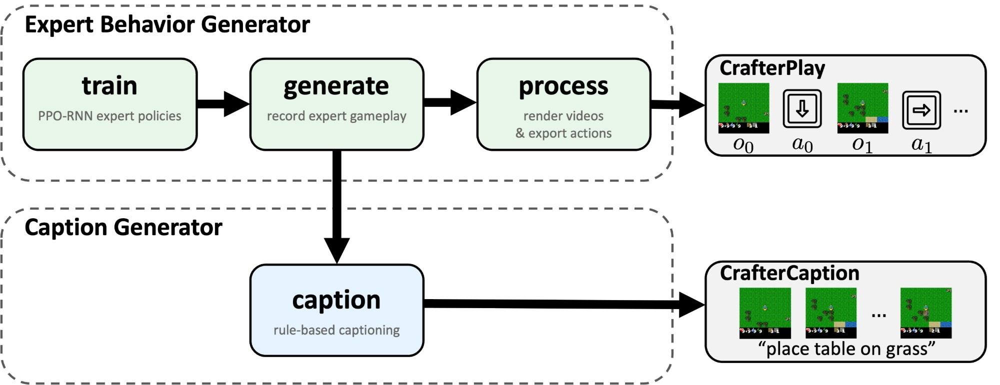
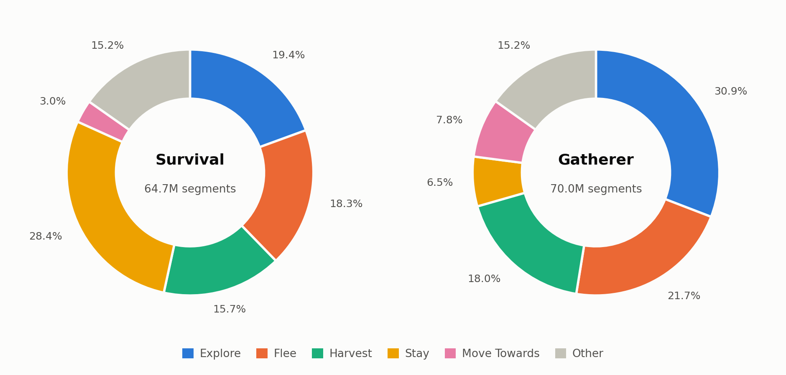
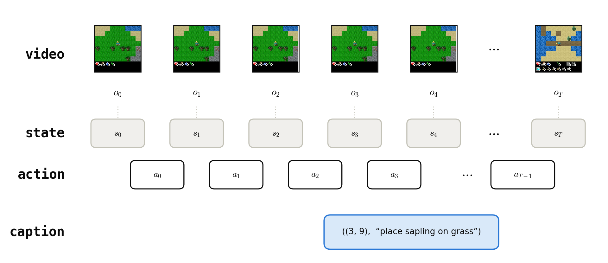

# CrafterDojo Datasets: CrafterPlay and CrafterCaption

CrafterDojo releases two datasets:

- **CrafterPlay** (Section 4.1 of the paper) — large-scale synthetic expert demonstrations (video, action,
  state, episode length) produced by the **Expert Behavior Generator** toolkit in
  Craftax-Classic (`Craftax-Classic-Symbolic-v1`), the fast JAX reimplementation of Crafter with
  the same 22 achievements.
- **CrafterCaption** (Section 5.1 of the paper) — aligned video–language pairs produced by the **Caption
  Generator** toolkit: rule-based captions attached to short video segments of CrafterPlay
  trajectories.

The release consists of two splits (license **CC0 1.0**):

| Split | Contents | Size |
|---|---|---|
| Survival (`survival-10B`) | 20,000 episodes from the *Survival* expert (all five fields) | ~459.9 GB |
| Gatherer (`gatherer-10B`) | 20,000 episodes from the *Gathering* expert (all five fields) | ~354.7 GB |

This release is the complete raw generation output (20,000 episodes per expert). The datasets
used in the paper are derived from it: the paper's CrafterPlay dataset (Section 4.1) combines
10,000 trajectories per expert, and its CrafterCaption dataset (Section 5.1) subsamples the raw
caption pairs to 1.2M uniformly over the 15 caption rules, with LLM-based paraphrase
augmentation. The raw
pool is released so that users can apply their own filtering, balancing, and splits.

---

## 1. Generation procedure

The data is produced by CrafterDojo's two automatic dataset generation toolkits (Section 3 of
the paper), included in the released codebase as `dataset_generation/expert_behavior` and
`dataset_generation/caption`:



- The **Expert Behavior Generator** trains PPO-RNN expert policies (10B timesteps each; the two
  splits differ only in the experts' reward shaping), records their gameplay as environment
  states, and renders videos and action files from them → **CrafterPlay**.
- The **Caption Generator** replays the recorded states and matches 15 behavioral rules to
  annotate short video segments with captions → **CrafterCaption**.

For a step-by-step walkthrough of every stage — including reproducing the paper's noop-filtered
C-VPT training data — see [GENERATION.md](GENERATION.md).

---

## 2. Dataset statistics

Computed over all 20,000 episodes of each released split.

### 2.1 Episodes

| | Survival | Gatherer |
|---|---|---|
| Episodes | 20,000 | 20,000 |
| Total frames | 176.7 M | 138.8 M |
| Episode length (mean) | 8,837 steps | 6,941 steps |
| Episode length (min / max) | 38 / 10,000 | 29 / 10,000 |
| Reached the 10,000-step cap | 80% | 58% |
| Policy training budget | 10B env steps | 10B env steps |
| Reward shaping | crafter reward + death penalty | crafter reward + gathering bonus + death penalty |

Episodes end early when the agent dies; the rest run to the 10,000-step cap.

### 2.2 Captions (CrafterCaption)

| | Survival | Gatherer |
|---|---|---|
| Caption segments (total) | 64.7 M | 70.0 M |
| Segments per episode (mean) | 3,235 | 3,500 |
| Unique caption texts | 61 | 61 |
| Caption rules | 15 | 15 |

The 61 texts are the template-based captions of Section 5.1 of the paper; the 15 rules span the four
categories Achievement, Movement, Construct, and Combat.



*Share of raw caption segments per split, top 5 rules; the remaining 10 rules are grouped as
Other.*

The two splits have visibly different behavioral profiles (e.g., the survival expert *stays* far
more; the gatherer expert *crafts* an order of magnitude more), which is the intent of releasing
both.

---

## 3. File organization

Each split is a directory tree with one subdirectory per field:

```
{gatherer-10B|survival-10B}/Craftax-Classic-Symbolic-v1/
  action/    action_<episode_id>.pkl
  state/     episode_<episode_id>.npz
  caption/   episode_<episode_id>.pkl
  len/       len_<episode_id>.txt
  video/     video_<episode_id>.mp4
```

Episode ids are zero-padded to five digits (`00000`–`19999`); one episode is fully described by
its five same-id files, one per field directory.

The *sample* stores the identical layout for the first five episodes of each split — ideal for
trying the loaders before committing to a large download.

---

## 4. Data formats

One episode is five files that share the frame axis: states and video frames have $T+1$
entries, actions sit between consecutive frames ($T$ entries), and captions annotate frame
ranges.



All snippets below only require `numpy` (plus `imageio` for video).

### 4.1 Episode length

> `len/len_<id>.txt`

Plain text, a single integer $T$ (number of actions taken). All per-step arrays are consistent
with it: actions have length $T$, states and video frames have length $T+1$.

```python
T = int(open("len/len_00000.txt").read())
```

### 4.2 Actions

> `action/action_<id>.pkl`

Pickled 3-tuple of NumPy arrays, each of length $T$:

| Index | Array | Dtype | Meaning |
|---|---|---|---|
| 0 | `action_ids` | int32 | Environment action id at each step (Craftax-Classic action space, 17 discrete actions) |
| 1 | `is_null` | bool | True where the action was a noop (no effect on the environment) — the basis of the noop filtering described in Section 4.2 of the paper |
| 2 | `is_sleeping` | bool | True while the agent is asleep |

```python
import pickle
action_ids, is_null, is_sleeping = pickle.load(open("action/action_00000.pkl", "rb"))
```

### 4.3 Environment state

> `state/episode_<id>.npz`

Compressed NumPy archive with **50 named arrays** covering the full environment state at
every step (states are recorded *before* each action, plus the final state, hence $T+1$
entries). Load with `np.load`.

```python
import numpy as np
state = np.load("state/episode_00000.npz")
print(state.files)                # 50 keys
achievements = state["achievements"]   # (T+1, 22) bool
```

| Array | Dtype | Shape (episode of length $T$) | Description |
|---|---|---|---|
| `action` | int32 | $T$ | Action id taken at each step (duplicate of `action/action_<id>.pkl` array 0) |
| `map` | int32 | $(T{+}1) \times 64 \times 64$ | Tile map (block type id per cell) |
| `mob_map` | bool | $(T{+}1) \times 64 \times 64$ | Boolean mask of cells occupied by mobs |
| `player_position` | int32 | $(T{+}1) \times 2$ | Player (row, col) position |
| `player_direction` | int32 | $T{+}1$ | Facing direction id |
| `player_health` | int32 | $T{+}1$ | Health points |
| `player_food` | int32 | $T{+}1$ | Food level |
| `player_drink` | int32 | $T{+}1$ | Drink level |
| `player_energy` | int32 | $T{+}1$ | Energy level |
| `is_sleeping` | bool | $T{+}1$ | Whether the player is sleeping |
| `player_recover` | float32 | $T{+}1$ | Health recovery accumulator |
| `player_hunger` | float32 | $T{+}1$ | Hunger accumulator |
| `player_thirst` | float32 | $T{+}1$ | Thirst accumulator |
| `player_fatigue` | float32 | $T{+}1$ | Fatigue accumulator |
| `inventory_wood` | int32 | $T{+}1$ | Inventory count of wood |
| `inventory_stone` | int32 | $T{+}1$ | Inventory count of stone |
| `inventory_coal` | int32 | $T{+}1$ | Inventory count of coal |
| `inventory_iron` | int32 | $T{+}1$ | Inventory count of iron |
| `inventory_diamond` | int32 | $T{+}1$ | Inventory count of diamond |
| `inventory_sapling` | int32 | $T{+}1$ | Inventory count of sapling |
| `inventory_wood_pickaxe` | int32 | $T{+}1$ | Inventory count of wood pickaxe |
| `inventory_stone_pickaxe` | int32 | $T{+}1$ | Inventory count of stone pickaxe |
| `inventory_iron_pickaxe` | int32 | $T{+}1$ | Inventory count of iron pickaxe |
| `inventory_wood_sword` | int32 | $T{+}1$ | Inventory count of wood sword |
| `inventory_stone_sword` | int32 | $T{+}1$ | Inventory count of stone sword |
| `inventory_iron_sword` | int32 | $T{+}1$ | Inventory count of iron sword |
| `zombies_position` | int32 | $(T{+}1) \times 3 \times 2$ | Positions of zombies (slot-based) |
| `zombies_health` | int32 | $(T{+}1) \times 3$ | Health of zombies |
| `zombies_mask` | bool | $(T{+}1) \times 3$ | Valid-slot mask for zombies |
| `zombies_attack_cooldown` | int32 | $(T{+}1) \times 3$ | Attack cooldown of zombies |
| `cows_position` | int32 | $(T{+}1) \times 3 \times 2$ | Positions of cows (slot-based) |
| `cows_health` | int32 | $(T{+}1) \times 3$ | Health of cows |
| `cows_mask` | bool | $(T{+}1) \times 3$ | Valid-slot mask for cows |
| `cows_attack_cooldown` | int32 | $(T{+}1) \times 3$ | Attack cooldown of cows |
| `skeletons_position` | int32 | $(T{+}1) \times 2 \times 2$ | Positions of skeletons (slot-based) |
| `skeletons_health` | int32 | $(T{+}1) \times 2$ | Health of skeletons |
| `skeletons_mask` | bool | $(T{+}1) \times 2$ | Valid-slot mask for skeletons |
| `skeletons_attack_cooldown` | int32 | $(T{+}1) \times 2$ | Attack cooldown of skeletons |
| `arrows_position` | int32 | $(T{+}1) \times 3 \times 2$ | Positions of arrows (slot-based) |
| `arrows_health` | int32 | $(T{+}1) \times 3$ | Health of arrows |
| `arrows_mask` | bool | $(T{+}1) \times 3$ | Valid-slot mask for arrows |
| `arrows_attack_cooldown` | int32 | $(T{+}1) \times 3$ | Attack cooldown of arrows |
| `arrow_directions` | int32 | $(T{+}1) \times 3 \times 2$ | Direction per arrow slot |
| `growing_plants_positions` | int32 | $(T{+}1) \times 10 \times 2$ | Positions of growing saplings |
| `growing_plants_age` | int32 | $(T{+}1) \times 10$ | Age of growing saplings |
| `growing_plants_mask` | bool | $(T{+}1) \times 10$ | Valid-slot mask for growing saplings |
| `light_level` | float32 | $T{+}1$ | Global day/night light level |
| `achievements` | bool | $(T{+}1) \times 22$ | Boolean achievement flags (22 Crafter achievements) |
| `state_rng` | uint32 | $(T{+}1) \times 2$ | Environment PRNG key at each step |
| `timestep` | int32 | $T{+}1$ | Environment timestep counter |

### 4.4 Captions (CrafterCaption)

> `caption/episode_<id>.pkl`

Pickled list of tuples `((start_frame, end_frame), caption_text, rule_name)`, e.g.

```python
import pickle
captions = pickle.load(open("caption/episode_00000.pkl", "rb"))
captions[0]   # ((2, 8), 'obtain sapling', 'Harvest')
```

`(start_frame, end_frame)` delimits the caption's 6-frame video segment — the paper's
$o_{t-4:t+1}$, where the action triggering the rule occurs near the end of the window and the
trailing frame captures its outcome (Section 5.1 of the paper, "Rule Matching"). Frame indices index into the video
frames / state arrays. Captions come from the closed vocabulary of 61 template captions across
15 rules (Section 2.2 above).

### 4.5 Rendered video

> `video/video_<id>.mp4`

144×144 MPEG-4, $T+1$ frames (one per state, including the final state). Frame $t$
shows the state *before* action $t$.

```python
import imageio.v2 as imageio
frames = np.stack([f for f in imageio.get_reader("video/video_00000.mp4")])  # (T+1, 144, 144, 3)
```
